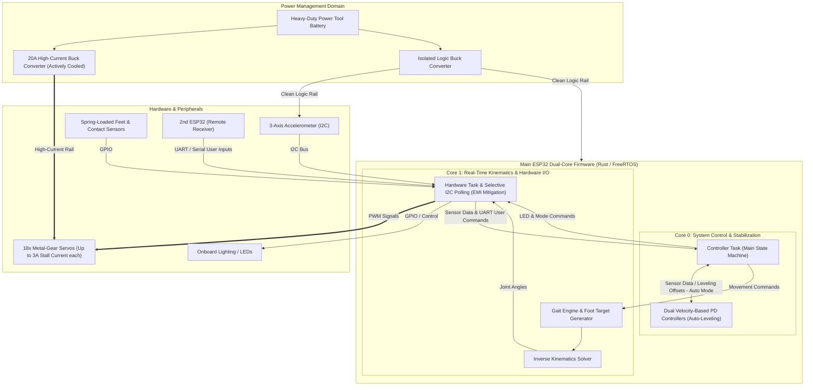

# Project ATLAS – Auto-Leveling Hexapod Testbed

**Project ATLAS** (*Auto-leveling Testbed for Load-Bearing Articulated Superstructures*) is a custom-built 18-DOF hexapod robot designed as a technology demonstrator for stabilized payload transport across uneven terrain. Developed entirely from scratch over a 3-month period, the project encompasses full-stack mechanical CAD design, custom PCB engineering, and dual-core real-time firmware written in **Embedded Rust**.

**[Watch the Demonstration Video](https://drive.google.com/file/d/1S2Hx6hAMKgyOhNaRciaC0PgEOIHzOwxt/view)**

**[Further Information on LinkedIn under "Projects"](https://www.linkedin.com/in/christoph-wilflingseder-465780413/)**

---

## Tech Stack & Tools

* **Firmware & RTOS:** Embedded Rust (`esp-idf-sys`), FreeRTOS (Dual-Core Task Isolation)
* **Hardware & PCB Design:** KiCad, ESP32, 3-Axis Accelerometer (I2C), 18x High-Torque Metal Gear Servos
* **Mechanical Engineering:** Solid Edge (CAD), Custom 3D-Printed Structural Components

---

## System Architecture

---

## Key Engineering Highlights

### 1. Mechanical Design & Kinematics Optimization
The chassis was engineered for maximum structural rigidity at minimal weight. Limb segment lengths (Coxa, Femur, Tibia) were mathematically optimized to balance the trade-off between required servo torque and overall workspace/range of motion. Each foot features mechanical suspension, articulated ground-contact pads, and tactile contact sensors for terrain adaptation.

### 2. High-Current Power Management & Brownout Prevention
Driving 18 metal-gear servos (with a stall current of up to 3A per actuator) places extreme demands on the power distribution network:
* **Actuator Rail:** Powered by a high-discharge power tool battery stepped down via an actively cooled 20A buck converter.
* **Logic Isolation:** To prevent microcontroller brownouts and system resets caused by massive transient current spikes during rapid gait transitions, the ESP32 and sensor logic are completely decoupled via a dedicated, isolated buck converter.

### 3. Dual-Core RTOS Firmware Architecture (Embedded Rust)
Built on top of `esp-idf-sys` and FreeRTOS, the firmware strictly partitions execution across both ESP32 cores to guarantee deterministic real-time performance:
* **Core 1 (Isolated Real-Time Engine):** Exclusively handles timing-critical inverse kinematics (IK) calculations and the gait engine. Also hosts the Hardware-Task to perform all hardware-interactions
* **Core 0 (Control & Comms):** Hosts the central Controller task (Main State Machine for robot behaviour). Velocity-based PD controllers process 3-axis accelerometer data to compute compensatory body tilts for the automatic leveling mode, which are integrated into the final foot target positions. Converts all user inputs into corresponding movement commands and sends them to the Core 1 tasks.

Additionally, to outsource the bluetooth controller interactions, a second ESP32 transmits the user inputs periodically to the main ESP via UART

### 4. Software-Defined EMI Mitigation (I2C Bus Protection)
**The Challenge:** During heavy multi-axis movement, strong electromagnetic interference (EMI) generated by the 18 servo motors induced current spikes into the sensitive I2C sensor lines, causing frequent bus lockups and sensor crashes.

**The Solution:** Resolved entirely in software without requiring a PCB redesign. By deactivating I2C polling during moments of peak servo activity (Mode change commands from the Controller to the Hardware Task), the I2C crashes were reduced close to zero.